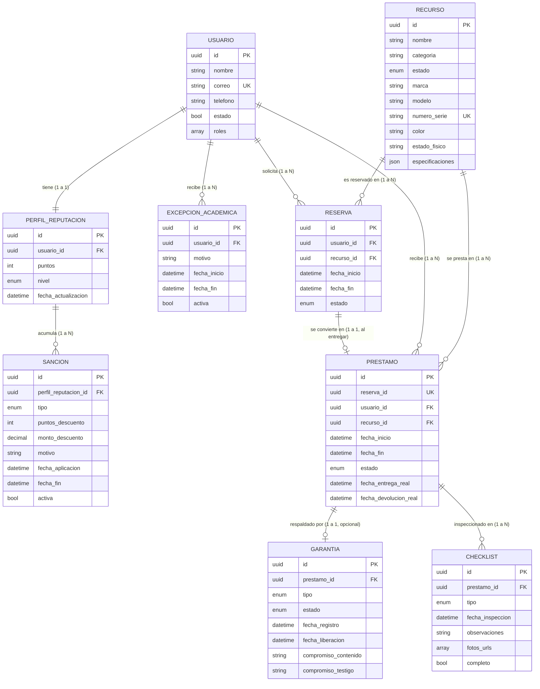

# Modelo de Datos (Entidad-Relación)

Vista simplificada de las entidades y relaciones del sistema **Préstamos de Recursos** (sin capas ni divisiones técnicas de DDD).

## Lectura rápida

* **`(1 a 1)`**: relación directa única (`Usuario` ↔ `PerfilReputacion`).
* **`(1 a 1, al entregar)` / `(1 a 1, opcional)`**: relación uno a uno que solo se crea cuando la reserva se entrega en ventanilla (una reserva nunca genera más de un préstamo).
* **`(1 a N)`**: uno a muchos (`1` usuario, recurso, perfil o préstamo puede tener `N` registros asociados a lo largo del tiempo).
